# VOIDPATH

A 2D-HD science-fiction RPG in the style of *Octopath Traveler*: pixel-art sprites and pixel-art
textures standing in a real, lit 3D diorama, with tilt-shift depth of field, bloom and a film grade,
and Octopath's Break/Boost turn-based battles. Four travelers, four chapters, a finale and an
epilogue: about two and a half to three hours from New Journey to THE END.

Everything you see and hear is generated by code at runtime: every texture, sprite, portrait, prop,
light, particle, song and sound effect. There are no image or audio files.

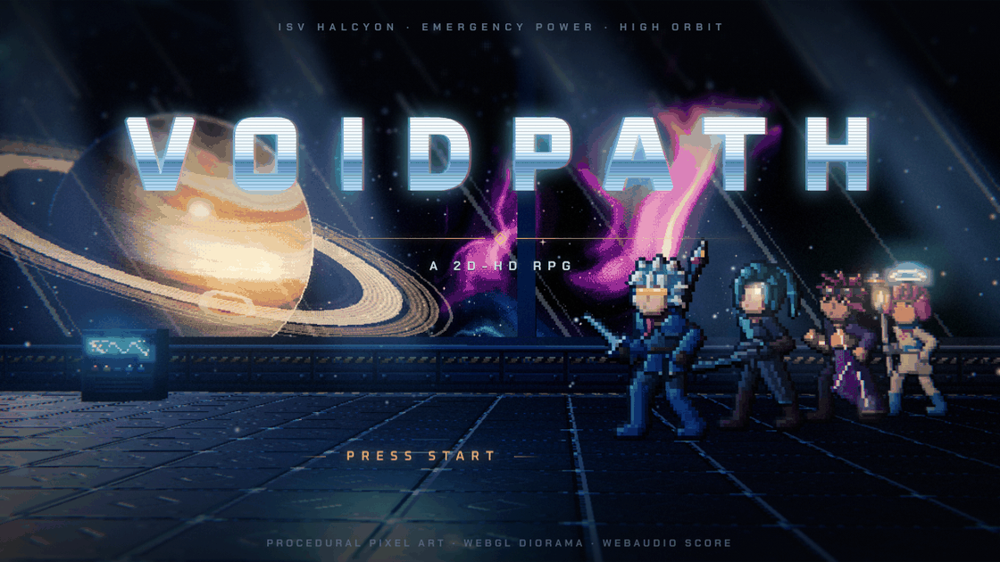

| | |
|---|---|
| 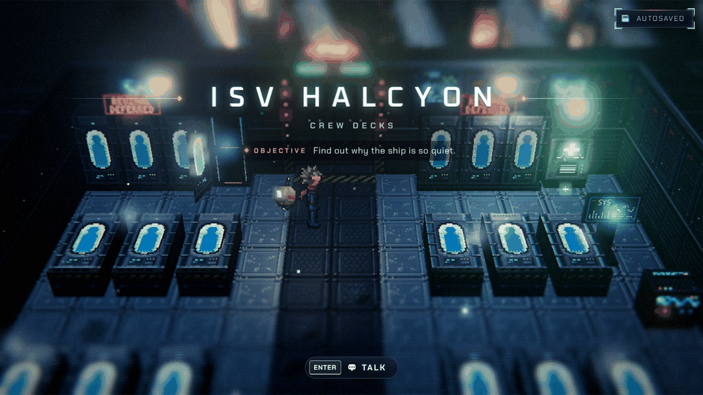 | 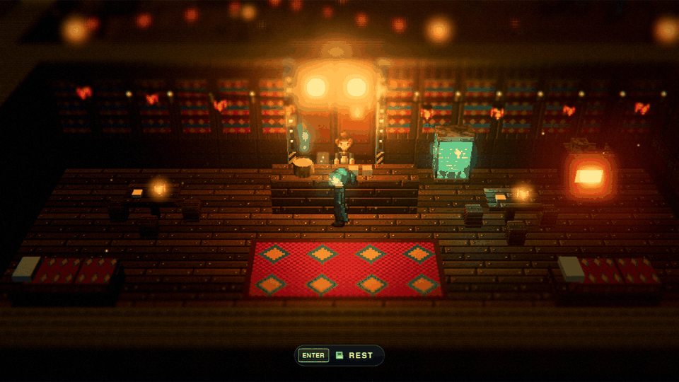 |
| 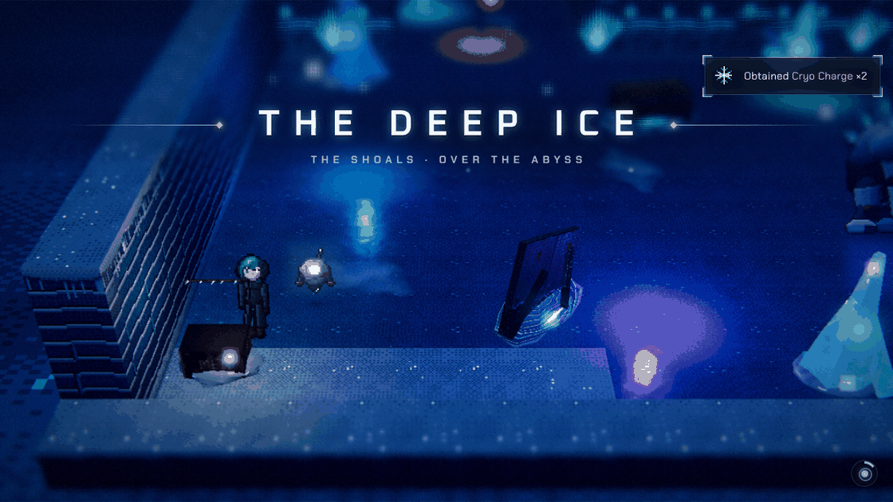 | 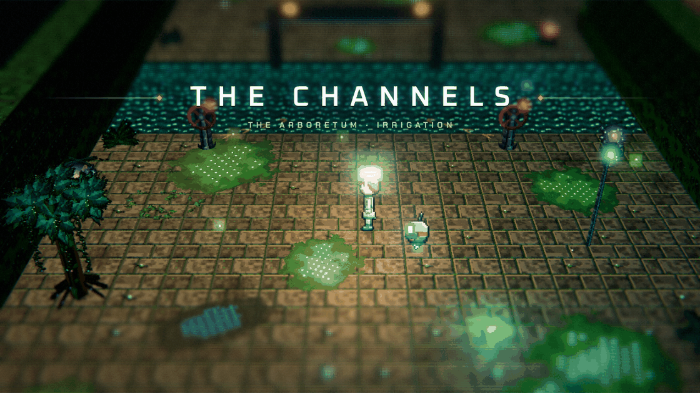 |
| 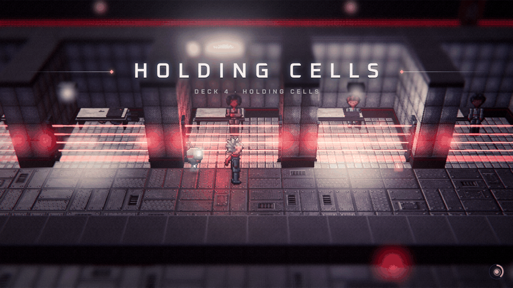 | 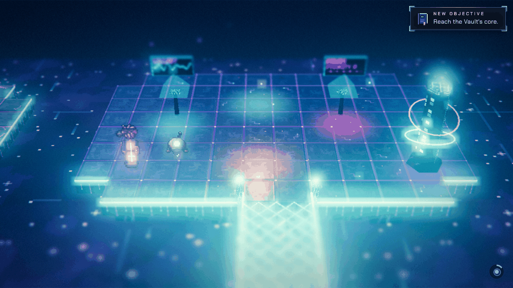 |
| 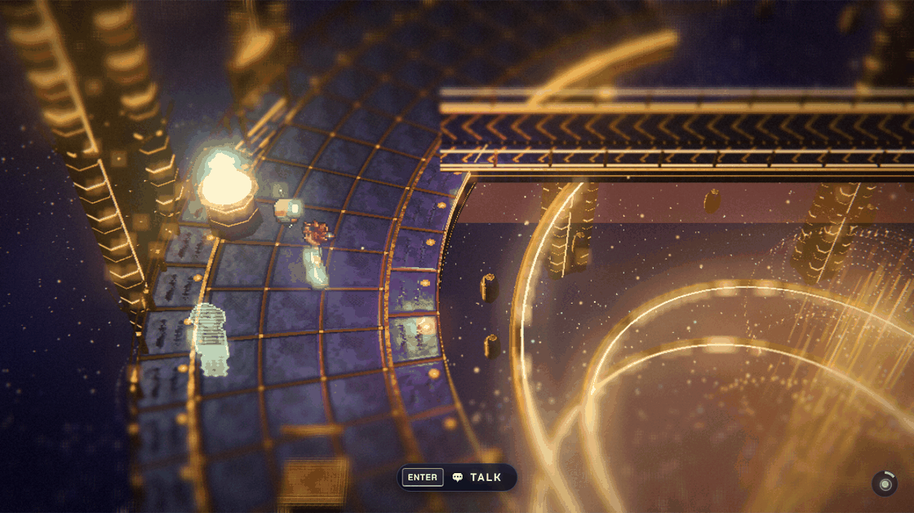 | 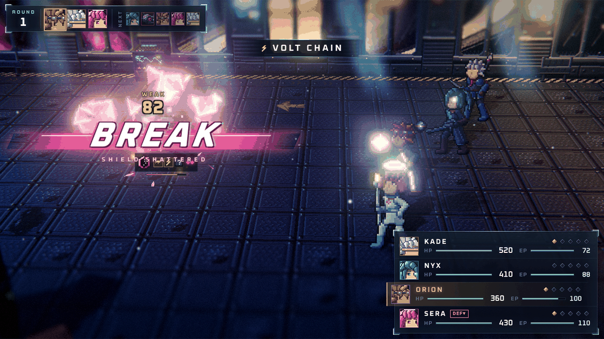 |
| 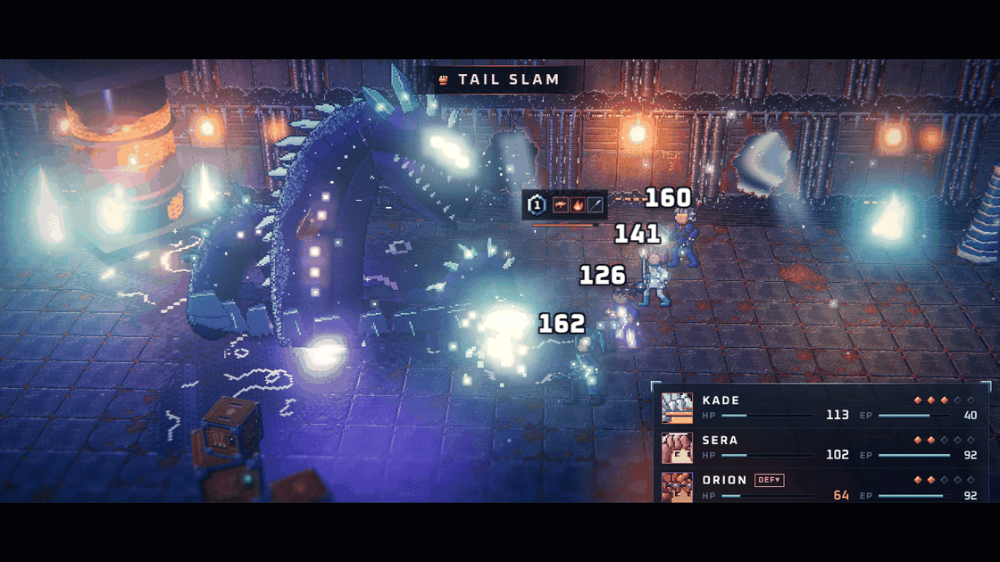 | 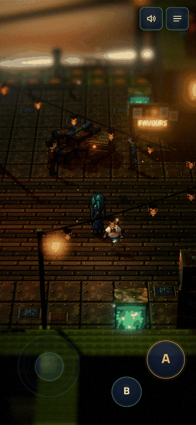 |

Screenshots come from headless Chromium with software rendering at 1280x720 (the phone at 390x844).

## The story

Four strangers wake aboard the **ISV Halcyon**, a generation colony ship carrying 12,000 sleepers.
It should be on its way to a new world. Instead it hangs in orbit above **Tethys**, a ringed gas
giant, on emergency power, and the pods around them read *REVIVAL DEFERRED*.

- **Prologue: Waking.** KADE, a security lieutenant, is woken by BOLT, a small maintenance robot
  that is far braver than its threat-assessment module allows. Through the Cryo Deck, the Spine
  Corridor and Engineering he finds SERA, a cryo-physician looking for her little brother's pod;
  ORION, the engineer who built the ship's mind; and NYX, a salvager caught hacking the bridge door.
  Something has taken the helm, and the ship's own Sentinels stand in the way.
- **Chapter One: Ringborn (Nyx).** The jump drive needs a lattice coil. The only one within reach
  is in the wreck of the **Meridian**, an older colony ship that reached Tethys 80 years ago and
  never left. Its survivors' descendants, the Ringborn, live in **Driftmarket**, a ring station
  built from the wreck. They do not like ship-people, and they have a legend about "the Lock that
  sings ships to sleep." Something large nests in the Meridian's frozen reactor hall.
- **Chapters Two to Four** each belong to one of the other travelers: **The Choir** (Sera),
  **The Oath** (Kade) and **Echoes** (Orion).
- **Final Chapter: Voidpath**, and an **epilogue**.

The rest is for you to find.

## How to play

### Controls

| Action | Keyboard | Gamepad | Touch |
|---|---|---|---|
| Move, navigate menus | Arrows / WASD | D-pad / left stick | Floating stick (lower left half of the screen) |
| Confirm, talk, open | Enter / Space / Z | A | A button, or tap a menu row |
| Cancel, back | Esc / X / Backspace | B | B button |
| Pause menu (field) | Tab / C | Start / Y | Menu button |
| Boost up / down (battle) | E / Q (also ] / [) | RB / LB | + / - buttons |
| Run (field) | Hold Shift | Hold X | Push the stick all the way |
| Speed up enemy turns (battle) | Hold Enter | Hold A | Hold A |
| Skip a scene you have already seen | Hold Esc | Hold B | Hold the B button (top right) |
| Skip the credits | Hold Enter | Hold A | Hold A |
| Mute | M | | Sound button |

### In the field

Walk up to people, terminals, chests and doors; a prompt shows what Confirm does. Party members
follow the leader, and in towns you can talk to each of them. The pause menu has the party (change
the leader and the order), equipment (with Optimize), items, the **Journal** (the current objective,
a hint, favours and the story so far), a **map** of the areas you have visited, settings and the
controls. In dungeon zones a danger gauge fills as you walk and a random encounter shatters the
screen into a battle. **Med-Stations** (and the Driftmarket inn) restore the party and set a
checkpoint. The Halcyon's **Bridge** is the hub: its **Starchart** flies the Moth to every unlocked
destination, and its fabricator and Driftmarket's shop sell gear.

### In battle

Everyone acts once per round in speed order; the turn bar shows this round and the next.

- **Shields and weaknesses.** Every enemy carries a shield count and hidden weaknesses ("?"): a
  weapon (blade, lance, rifle, gauntlet) or an element (thermal, cryo, volt, photon, void). Each hit
  of a type it is weak to reveals that weakness and knocks off one shield point.
- **Break.** At zero shield the enemy is **BROKEN**: it loses its next actions, takes double damage
  and recovers a round later. Find the weaknesses, Break, then unload.
- **Boost.** Each traveler gains 1 BP per round (up to 5) unless they boosted the round before.
  Spend up to 3 BP before acting: a boosted attack hits once more per BP, a boosted skill hits
  harder or heals more. Multi-hit boosted attacks are the fastest way to strip a shield.
- **Defend** halves damage until your next turn and moves you to the front of the next round. Watch
  for telegraphed attacks: a warning banner or a lock-on reticle means Defend now.
- **Ultimates.** Each traveler awakens an ultimate during their own chapter's boss fight. It costs
  exactly 3 BP and can be used once per battle.
- Enemies teach new tricks as the journey goes on: sleep, summons, marks, jams, phasing out of
  reach, shifting weaknesses. A tip explains each one the first time it appears.
- **Flee** works in regular fights, never against a boss. If the party falls, **Retry** restarts the
  fight from the last checkpoint (bosses skip straight back to the battle; the final boss can also
  be retried from its second form).

### Saving

- The game **autosaves** when you arrive somewhere new, after every chapter card and after every
  boss. A small "Autosaved" toast confirms it.
- Use the **Save** choice at a Med-Station or the inn for three manual files. **Continue** on the
  title screen loads your latest save; **Load** picks any of them.
- Saves live in the browser's local storage. Where storage is blocked (some embedded views, private
  windows) the game says so once and keeps your progress until the page closes.
- Settings (in the pause menu): difficulty (Story / Normal), encounter rate, battle speed, text
  speed, skip weak encounters, sound, music and effects volumes, and graphics quality.

## Features

- A dozen maps, from the Halcyon's steel-blue crew decks to a ring-station town
  of lantern-lit stalls, ice tunnels through the rings, an overgrown biodome, a security tower on
  red alert, a dive into a mind made of light, and a vertical reactor-cathedral.
- Six boss fights with scripted mechanics (lock-ons, submerging, summons, overclocking, phasing,
  a two-form final boss), each traveler's ultimate awakening at their story's turning point,
  elites, and more than 25 kinds of regular enemies that each bring one new trick.
- Levels 1 to 32, equipment with a comparison view and Optimize, shops, chests, favours, Party
  Talks, a Journal with recaps, and a world that reacts as the story moves on.
- A cutscene system with staging, camera moves, letterboxing, chapter cards and dream vignettes;
  every line written for one voice per character.
- Procedural music for every area and boss (WebAudio synthesis) with recurring motifs, and
  procedural sound effects.
- Plays on desktop and phones: keyboard, gamepad and touch; layouts from 390x844 portrait to 1920x1080;
  three graphics quality levels with an automatic step down when frames run long.

## Run it

The game is one self-contained page. Open `dist/index.html` in a recent desktop or mobile browser:
three.js is bundled in, so it works offline straight from disk. `dist/artifact.html` is the same
game as a page fragment that loads three.js from the jsdelivr CDN, for publishing as an Artifact.

Graphics quality (low / medium / high) is in the pause menu's settings and is remembered; touch
devices start on medium. `dist/index.html?q=low` forces a level for one visit, and `?stats=1` shows
an overlay with fps, frame time, draw calls and memory.

## Build and test

```
npm install
npm run build          # minified: dist/index.html (standalone) and dist/artifact.html (fragment)
npm run build:dev      # readable bundle; add --only main or --only preview-<name> for one entry
npm test               # unit tests (node --test): rules, battle model, story runner, saves, content lints
npm run scriptcheck    # dry-runs every story script: budgets, ids, staging, reading time per chapter
npm run balance -- --check   # campaign simulator: levels, fight counts and win rates for every chapter
npm run scenarios      # end-to-end scripted runs in headless Chromium with --strict (needs Playwright)
npm run play -- dist/index.html --steps tests/scenarios/03-battle.json   # one scripted run with screenshots
npm run pace -- --start title          # human-pace playthrough on a virtual clock (hours)
npm run pace:report -- <out dir>       # its pacing summary again
npm run contact        # contact sheets of every location's viewpoints
npm run fights         # expected random fights per chapter from the walked distance
```

The browser tools (`tools/play.mjs`, `tools/scenarios.mjs`, `tools/human-pace.mjs`,
`tools/contact-sheet.mjs`) drive headless Chromium through Playwright and share three machine-wide
browser slots, because software rendering runs on the CPU. `dist/tools/*.html` are per-module
preview pages built from `src/tools/`.

`window.__VP.debug` exposes hooks for tests: `jumpTo(chapterOrJump)`, `startBattle(id, { seed })`,
`state()`, `pacing()`, `renderInfo()`, `visualLint()`, `missingArt()`, `autoplay(mode)` and more
(TECH_PLAN.md section 10.1).

## Project layout

```
src/
  main.js               boot: engine, input, audio, UI, content registry, debug hooks
  core/                 engine and post FX, game state machine, input, audio, state, progression,
                        shop, save, quality tiers and perf, shader program cache, title scene
  world/                multi-map field: map definitions, builder, lighting rig, camera, player,
                        NPC actors, props, sky and water, conditions, ExploreState
  story/                story state, cutscene runner and its cs API, chapter jumps, Starchart travel
  battle/               rules (data, model, boss scripts) and presentation (stage, arena, director,
                        action fx, battle UI)
  art/                  procedural pixel art: characters, enemies, tiles, icons, fx, the art cache
  ui/                   DOM UI: dialog, cards, HUD, pause menu tabs, shop, Starchart, saves, title
  content/
    registry.js         merges every location module into one registry (maps, scripts, enemies, ...)
    common/             party, skills, items, equipment, kits, shared story and tips
    prologue/ driftmarket/ shoals/ arboretum/ spire/ vault/ heart/ warden/ dreams/ epilogue/
                        one folder per location: maps, data, story, art, enemy art, props, arenas, fx
    balance.js          every tuned number in one place
  tools/                preview pages, one per module
tests/
  *.test.mjs            unit tests and content lints (node --test)
  scenarios/*.json      end-to-end scripted runs
  routes/*.mjs          human-pace routes per location
  campaign.mjs, policy.mjs, simulate.mjs   balance simulator and the human-like battle policy
tools/                  headless runners: play, scenarios, human-pace, contact sheets, script check
build.mjs               esbuild bundle inlined into dist/*.html
STORY.md                the story bible
WRITING.md              house style, voice sheet, canon and the scene inventory
TECH_PLAN.md            the technical plan: contracts, budgets, the work breakdown and its deviations
MODULE_NOTES.md         notes from each module's author
docs/gates/             review gate verdicts, task reports and the release report (RELEASE.md)
```

## How the 2D-HD look is made

- **Pixel art everywhere.** Every texture and sprite is painted procedurally at 32 texels per world
  unit and nearest-filtered, so it stays crisp at any resolution.
- **Lit sprites.** Characters are planes that lean back toward the camera. Each sprite sheet gets an
  auto-generated normal map, so coloured point lights rim-light the pixel art, and emissive pixels
  (visors, LEDs, screens, energy cores) glow.
- **A miniature diorama.** A narrow-FOV camera looks down from about 34 degrees; walls in front of
  the player sink to cutaway height, so rooms read like a model on a table.
- **Lights and atmosphere.** One shadow-casting key light per map plus a fixed pool of coloured point
  lights per quality tier, volumetric light shafts, fog, dust, frost, steam, embers and sparks.
- **Lens and grade.** Bloom, a two-pass tilt-shift blur that keeps a band around the action sharp,
  ACES tone mapping, then a grade with vignette, split toning, film grain and a little chromatic
  aberration.
- **Juice.** Glass-shatter encounter transitions, hit-stop and screen shake on Breaks, cut-ins for
  ultimates, and stacked damage numbers.

## Credits

- Story, design, code, pixel art, music and sound: written in code by a team of Claude agents
  (Anthropic) working from STORY.md, WRITING.md and TECH_PLAN.md, with review gates for writing,
  art, pacing and balance.
- Built with [three.js](https://threejs.org/) r170 and [esbuild](https://esbuild.github.io/); tests
  use Node's test runner and [Playwright](https://playwright.dev/).
- Fonts: Oxanium, Chakra Petch and Silkscreen (Google Fonts, SIL Open Font License).
